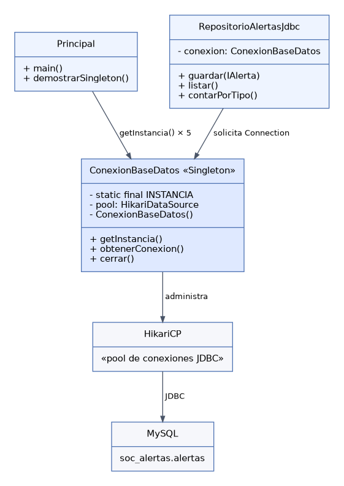
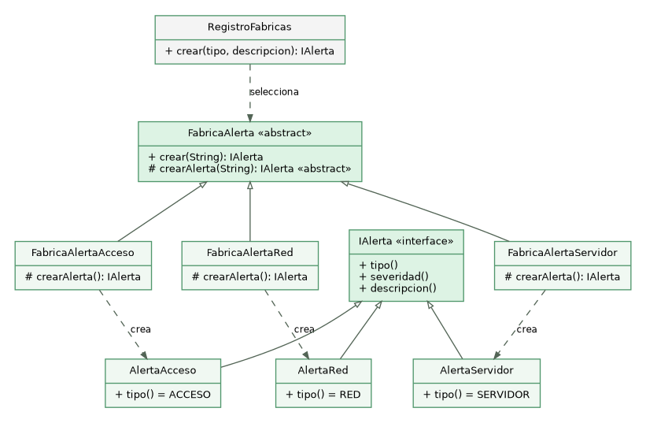

# Explicación técnica del código — Singleton, Factory Method y SOLID

## 1. Objetivo y contexto

Este es un **simulador de alertas de ciberseguridad ejecutado por consola**. Usa **MySQL** para persistir los datos y contiene **ambos patrones en el mismo código**. El usuario genera manualmente un evento como `RED`, `ACCESO` o `SERVIDOR`; se construye el objeto correspondiente mediante **Factory Method** y se almacena mediante **Singleton + JDBC/HikariCP + MySQL**. No tiene interfaz gráfica, servidor web ni detección real de ciberataques.

## 2. Singleton — `ConexionBaseDatos`

Código principal (`src/main/java/ec/edu/espe/soc/singleton/ConexionBaseDatos.java`):

```java
private static final ConexionBaseDatos INSTANCIA = new ConexionBaseDatos();
private ConexionBaseDatos() { }
public static ConexionBaseDatos getInstancia() { return INSTANCIA; }
```

1. **`private static final`** crea y mantiene la referencia única por cargador de clases en la JVM.
2. **Constructor `private`** impide `new ConexionBaseDatos()` desde `Principal` u otras clases.
3. **`getInstancia()`** permite obtener siempre el gestor existente.
4. **`inicializarSiNecesario()`** configura una sola vez el pool HikariCP en la primera petición de conexión. Está sincronizado para impedir inicializaciones duplicadas.
5. **`obtenerConexion()`** entrega una conexión temporal prestada por el pool. La devuelve al pool cuando el repositorio usa `try-with-resources`.
6. **`cerrar()`** libera el pool al terminar la aplicación.

**Demostración requerida:** opción **4**. Solicita cinco veces `ConexionBaseDatos.getInstancia()`, imprime `System.identityHashCode()` e indica `primera == actual` en cada solicitud. Los cinco valores suelen ser iguales porque es el mismo objeto; **`==` es la prueba directa de identidad**. Eso muestra reutilización del gestor, **no demuestra cuánta memoria se ahorra**.

**Aclaración JDBC:** no sería correcto compartir una única conexión física JDBC para todas las operaciones de una aplicación concurrente. Un Singleton gestiona el **pool**; HikariCP mantiene las conexiones, que son recursos separados. Un Singleton tampoco crea una única instancia para distintos equipos o procesos distribuidos.



## 3. Factory Method — creación de alertas

**Producto abstracto:** `IAlerta` define `tipo()`, `severidad()` y `descripcion()`.

**Productos concretos:**

- `AlertaAcceso`: tipo `ACCESO`, severidad didáctica `ALTA`.
- `AlertaRed`: tipo `RED`, severidad didáctica `MEDIA`.
- `AlertaServidor`: tipo `SERVIDOR`, severidad didáctica `CRITICA`.

**Creator abstracto:** `FabricaAlerta` define este **Factory Method**:

```java
protected abstract IAlerta crearAlerta(String descripcion);
```

El método público `crear(descripcion)` realiza validaciones comunes y delega la decisión a ese método. La fábrica concreta lo sobrescribe:

```java
public final class FabricaAlertaRed extends FabricaAlerta {
    @Override public String tipo() { return "RED"; }
    @Override protected IAlerta crearAlerta(String descripcion) {
        return new AlertaRed(descripcion);
    }
}
```

La clase `RegistroFabricas` implementa `IProveedorAlertas` y contiene un mapa `tipo -> FabricaAlerta`. Recibe un texto (por ejemplo `"red"`), busca una fábrica y llama a `crear(descripcion)`. No construye alertas directamente; **el `new` del producto está encapsulado en la fábrica concreta**.

```text
Texto "RED" -> RegistroFabricas -> FabricaAlertaRed
                                 -> crearAlerta("Tráfico simulado")
                                 -> AlertaRed implements IAlerta
```

**¿Por qué es Factory Method y no solo Simple Factory?** Porque hay una **jerarquía de creadores** con un método de fábrica **abstracto** y distintas subclases que implementan polimórficamente cómo crear cada producto. Un `switch` que ejecutara `new AlertaAcceso()/new AlertaRed()` directamente en `Principal` no cumpliría esa estructura.

**Demostración requerida:** opción **5**. Crea una alerta de cada tipo e imprime su clase concreta, sin tocar MySQL. Opción **1** utiliza el mismo Factory Method para registrar realmente el objeto creado.



## 4. Uso conjunto de los dos patrones (misma opción de menú)

**Opción 1 — Crear y guardar alerta en MySQL:**

```text
Principal (lee "RED" y descripción)
  ↓
ServicioAlertas.registrar(tipo, descripcion)
  ↓
RegistroFabricas.crear("RED", descripcion)
  ↓
FabricaAlertaRed.crearAlerta(...)   [FACTORY METHOD]
  ↓
AlertaRed : IAlerta
  ↓
RepositorioAlertasJdbc.guardar(IAlerta)
  ↓
ConexionBaseDatos.getInstancia()   [SINGLETON]
  ↓
HikariCP → Connection → PreparedStatement → INSERT MySQL
  ↓
AlertaRegistrada con identificador y fecha
```

- La clase **Principal** administra la interacción con el usuario y conecta dependencias al inicio (*composition root*).
- La clase **ServicioAlertas** coordina el caso de uso y recibe un `IRepositorioAlertas` (interfaz).
- La clase **RepositorioAlertasJdbc** solo se encarga del SQL y se conecta a MySQL mediante el gestor Singleton.
- La sentencia `INSERT` utiliza parámetros `?` y `PreparedStatement`, por lo que no concatena entradas del usuario en el SQL.
- `try-with-resources` devuelve conexiones al pool y cierra statements/result sets, incluso si se produce un error.

## 5. SOLID aplicado con referencias concretas

| Principio | Descripción | Evidencia en el código |
|---|---|---|
| **S – SRP (responsabilidad única)** | Cada clase tiene una razón principal para cambiar. | `Principal` presenta el menú; `ServicioAlertas` coordina; cada `FabricaAlertaX` crea un tipo; `RepositorioAlertasJdbc` gestiona sentencias SQL; `ConexionBaseDatos` controla el pool. |
| **O – OCP (abierto/cerrado)** | Extensión mediante nuevas clases sin alterar las fábricas existentes. | Para agregar `AlertaCorreo` se crea `AlertaCorreo` y `FabricaAlertaCorreo`; se registra en el punto de composición `Principal`, sin cambiar `FabricaAlerta`, `ServicioAlertas` ni `RepositorioAlertasJdbc`. **Sí requiere actualizar la configuración de fábricas**. |
| **L – LSP (sustitución de Liskov)** | Un subtipo se puede usar como su abstracción. | `AlertaAcceso`, `AlertaRed` y `AlertaServidor` implementan `IAlerta`; el repositorio puede guardar cualquiera. Todas las fábricas concretas heredan de `FabricaAlerta`. |
| **I – ISP (segregación de interfaces)** | Interfaces enfocadas, sin métodos que no corresponden al cliente. | `IAlerta` contiene los tres datos mínimos; `IRepositorioAlertas` declara solo guardar, listar y contar por tipo. Ninguna alerta debe implementar operaciones de MySQL. |
| **D – DIP (inversión de dependencias)** | El negocio depende de contratos más que de detalles técnicos. | `ServicioAlertas` recibe `IRepositorioAlertas` y `IProveedorAlertas`, sin depender de las implementaciones JDBC y RegistroFabricas. El repositorio y el proveedor se pueden sustituir por implementaciones de prueba. Las fábricas devuelven `IAlerta`. |

**Sobre `new`:** no está prohibido por los patrones. `new AlertaRed(...)` se encuentra en `FabricaAlertaRed`, donde corresponde. El `Principal` utiliza unos pocos `new` al **configurar dependencias iniciales**, en lugar de construir alertas al procesar cada solicitud.

## 6. Qué NO afirma este ejemplo

- No prueba una reducción cuantificable del uso de RAM a través del hash.
- No crea un Singleton compartido por varias máquinas o JVM.
- No simula ataques reales ni actúa como sistema de defensa de red.
- No determina severidades conforme a una norma; son etiquetas ilustrativas.
- No elimina por completo `new`; encapsula la **creación variable**.