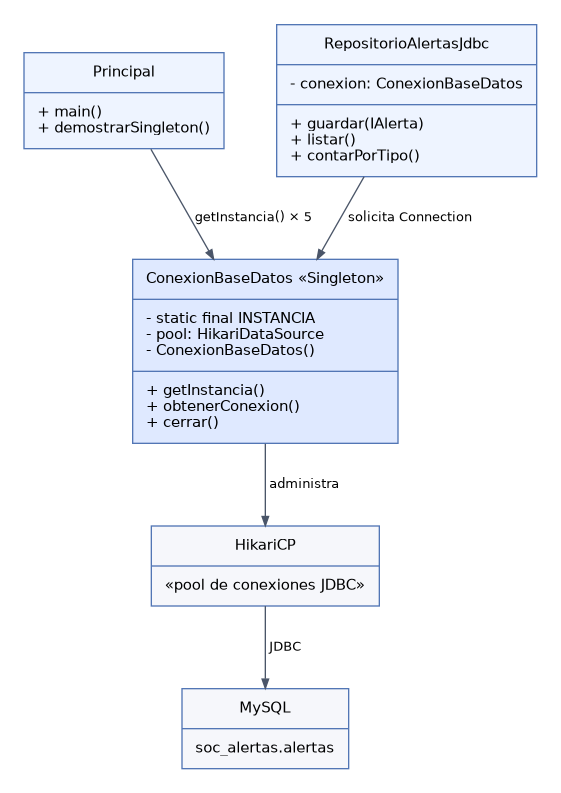
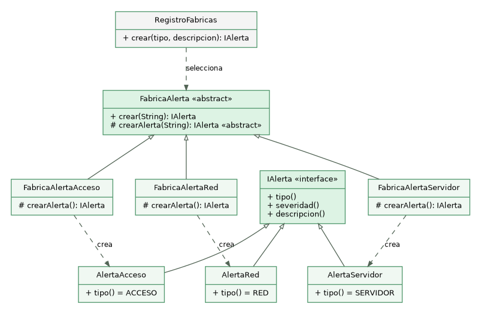

# SOC Alertas de Ciberseguridad — Java + MySQL (consola)

Proyecto educativo para **Aplicaciones Distribuidas — Grupo 1: patrones creacionales**. Implementa **Singleton y Factory Method juntos** en un mismo flujo, con persistencia MySQL, programación orientada a objetos, abstracciones y principios SOLID.

> **Sin interfaz web ni gráfica.** No usa Spring Boot. Solo imprime y lee texto en la **consola de IntelliJ IDEA**. Las alertas son **ficticias y registradas manualmente**; no detecta intrusiones reales.

## Requisitos

- JDK **21** (seleccionar en IntelliJ IDEA).
- IntelliJ IDEA y acceso a Internet la primera vez para descargar dependencias Maven.
- **MySQL Server 8+** para guardar y consultar alertas (MySQL Workbench es opcional).
- Maven: IntelliJ lo integra; no hace falta instalar Maven por separado si ejecutas `Principal` dentro del IDE.

Dependencias en `pom.xml`: **MySQL Connector/J 26.10.0**, **HikariCP 7.1.0** y **SLF4J Simple 2.0.20**. Maven las descargará automáticamente.

## Arranque paso a paso en Windows e IntelliJ IDEA

1. **Descomprime** este ZIP en tu carpeta de actividades. Abre **IntelliJ IDEA → Open** y selecciona la carpeta `SOC_Alertas_Consola_MySQL` o su `pom.xml` como proyecto Maven. Cuando pregunte, **Trust Project** si confías en el archivo. Selecciona **Project SDK: JDK 21**. Espera a que Maven cargue las dependencias (usa el botón *Reload All Maven Projects* si es necesario).
2. **Crea la base de datos**: abre MySQL Workbench, conéctate a tu servidor local y ejecuta **todo** `database/schema.sql`. El script crea la base `soc_alertas` y la tabla `alertas` (sin eliminar registros anteriores). En la consola MySQL también puedes ejecutar `SOURCE C:/ruta/del/proyecto/database/schema.sql;` adaptando la ruta.
3. En el explorador de archivos **duplica** `config/database.properties.example` y renombra la copia a `config/database.properties`. Coloca **tu usuario y contraseña reales** de MySQL, sin modificar el archivo `.example`.

   Ejemplo de `config/database.properties` (cambia la clave):

   ```properties
   jdbc.url=jdbc:mysql://localhost:3306/soc_alertas?serverTimezone=UTC
   jdbc.user=root
   jdbc.password=TU_CONTRASENA_REAL
   pool.maximo=5
   ```

   El archivo `database.properties` está excluido de Git mediante `.gitignore` y **no debe subirse**. Si la contraseña contiene caracteres especiales, usa el valor literal dentro de ese archivo.
4. Ejecuta **`src/main/java/ec/edu/espe/soc/Principal.java`**, botón derecho → **Run 'Principal.main()'**. Escribe las opciones en la ventana **Run**.
5. Primero usa la opción **6 (Comprobar conexión MySQL)**. Luego usa **1 (Registrar)**, **2 (Historial)**, **3 (Estadísticas)**, **4 (Singleton)** y **5 (Factory Method)**.
6. Si aún no has preparado MySQL, **las opciones 4 y 5 sí funcionan**, ya que son demostraciones independientes de la base. Las opciones 1, 2, 3 y 6 necesitan conexión MySQL.

**Alternativa por terminal** desde la carpeta raíz (con Maven instalado):

```bat
mvn clean compile
mvn exec:java
```

**Prueba automática de patrones sin MySQL:** botón derecho en `PruebasPatrones.java` → **Run**. Comprueba cinco referencias, tres tipos de fábrica y rechazo de tipos inválidos.

## Menú

```text
=========== SOC - ALERTAS DE CIBERSEGURIDAD ===========
1. Crear y guardar alerta en MySQL (ambos patrones)
2. Mostrar historial desde MySQL
3. Estadisticas de alertas
4. Demostracion Singleton (5 referencias)
5. Demostracion Factory Method (sin DB)
6. Comprobar conexion MySQL
0. Salir
Opcion:
```

Ejemplo de registro con ambos patrones trabajando juntos:

```text
Opcion: 1
Tipos disponibles: [ACCESO, RED, SERVIDOR]
Tipo (ACCESO/RED/SERVIDOR): RED
Descripcion del evento ficticio: Trafico anomalo en la red de prueba
[FACTORY METHOD] Se creo el tipo: RED
[SINGLETON + MYSQL] Alerta guardada, ID: 1
Severidad: MEDIA
Descripcion: Trafico anomalo en la red de prueba
```

**La salida exacta puede variar** según los registros almacenados. El patrón Factory Method crea el `IAlerta`, el repositorio utiliza el gestor Singleton para solicitar conexiones del pool y finalmente un `INSERT` guarda la alerta en MySQL. La opción 2 recupera el historial **desde la base de datos**, no desde una lista local.

## Diseño

- **Singleton:** `singleton/ConexionBaseDatos.java` define un constructor privado y un `static final` con la instancia única. Devuelve el **mismo gestor** cinco veces; `==` verifica identidad y `System.identityHashCode()` permite visualizarlo. El gestor administra un **pool HikariCP**, no una sola conexión JDBC compartida. El pool se crea al conectar por primera vez y se cierra al salir.
- **Factory Method:** `factory/FabricaAlerta.java` declara el método abstracto `crearAlerta(...)`. `FabricaAlertaAcceso`, `FabricaAlertaRed` y `FabricaAlertaServidor` sobrescriben ese método y construyen el producto concreto. Todas las alertas implementan `modelo/IAlerta`. `RegistroFabricas` selecciona una fábrica a partir de un texto como `RED`.
- **SOLID:** las fábricas crean objetos, el servicio coordina, el repositorio persiste y el Singleton gestiona conexiones; el servicio depende de `IRepositorioAlertas` y de `IAlerta`, no del SQL ni de los productos concretos.

### UML y documentación





- [`EXPLICACION_PATRONES_SOLID.md`](EXPLICACION_PATRONES_SOLID.md): explicación línea a línea del recorrido y los cinco principios SOLID.
- [`GUIA_EXPOSICION_Y_GITHUB.md`](GUIA_EXPOSICION_Y_GITHUB.md): reparto, Live Coding, ramas, commits y Pull Requests.
- [`database/schema.sql`](database/schema.sql): estructura de MySQL.

## Estructura de carpetas

```text
SOC_Alertas_Consola_MySQL/
├── pom.xml
├── .gitignore
├── README.md
├── EXPLICACION_PATRONES_SOLID.md
├── GUIA_EXPOSICION_Y_GITHUB.md
├── config/
│   └── database.properties.example
├── database/
│   └── schema.sql
├── docs/
│   ├── uml-singleton.png
│   └── uml-factory-method.png
└── src/main/java/ec/edu/espe/soc/
    ├── Principal.java
    ├── PruebasPatrones.java
    ├── singleton/ConexionBaseDatos.java
    ├── factory/{FabricaAlerta,...,RegistroFabricas}.java
    ├── modelo/{IAlerta,AlertaAcceso,AlertaRed,AlertaServidor,AlertaRegistrada}.java
    ├── repositorio/{IRepositorioAlertas,RepositorioAlertasJdbc}.java
    └── servicio/ServicioAlertas.java
```

## Errores frecuentes

| Situación | Solución |
|---|---|
| `Falta config/database.properties` | Copia el `.example` a `config/database.properties` y edita las credenciales. Ejecuta el proyecto desde la carpeta raíz. |
| `Unknown database 'soc_alertas'` | Ejecuta `database/schema.sql` en MySQL. |
| `Access denied for user` | Corrige usuario/contraseña o permisos de ese usuario. |
| `Communications link failure` | Verifica que MySQL Server esté encendido y escuche en `localhost:3306`. |
| `Table 'soc_alertas.alertas' doesn't exist` | Ejecuta la parte de `CREATE TABLE` del SQL. |
| `package com.zaxxer.hikari does not exist` | En IntelliJ, **Reload All Maven Projects** y asegúrate de tener Internet y Maven operativo. |
| `release version 21 not supported` | Selecciona JDK 21 en **Project Structure → Project SDK** y en la configuración de Maven Runner. |

## Notas sobre las limitaciones

- `System.identityHashCode()` **no mide la memoria** ni garantiza por sí solo que dos referencias sean iguales: se verifica también con `==`.
- El Singleton es **por proceso JVM y cargador de clases**, no una instancia compartida por toda una arquitectura distribuida.
- `ConexionBaseDatos` comparte **el gestor del pool**; cada operación pide y devuelve una conexión mediante `try-with-resources`, evitando compartir imprudentemente un mismo `Connection`.
- La asignación de severidad es **didáctica y fija**. Las alertas se introducen manualmente y el sistema **no monitorea ni interviene redes reales**.
- Para un sistema de producción serían necesarios autenticación, configuración segura de TLS, análisis de eventos reales, registros de auditoría y pruebas de concurrencia.
